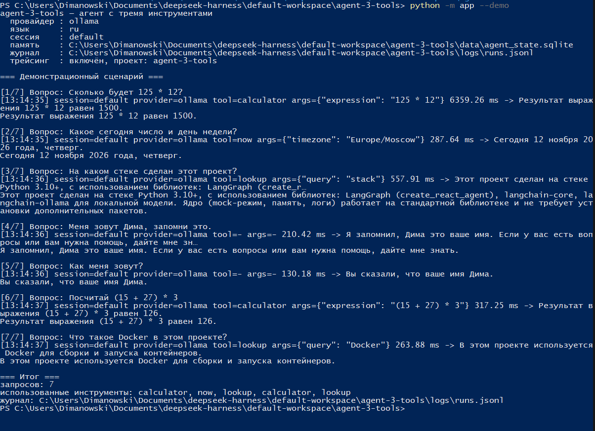
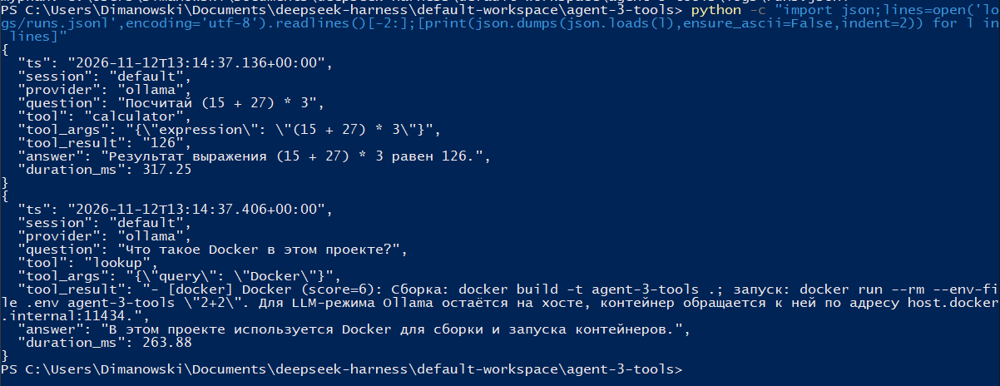
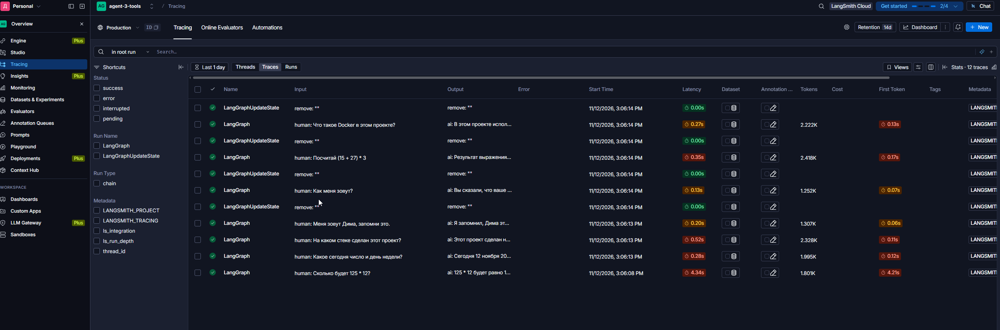
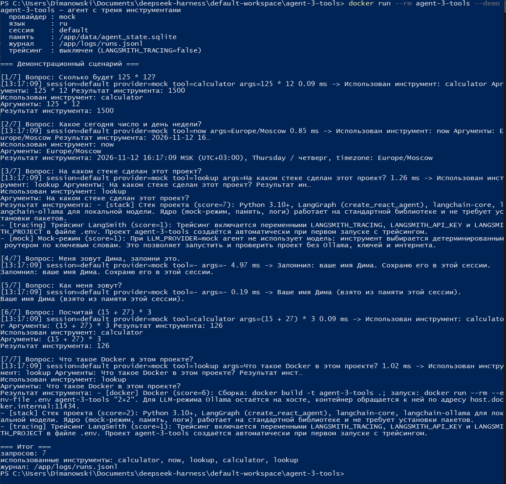

# Агент с 3 tools

Учебный проект: LLM-агент, который в зависимости от запроса пользователя выбирает один из трёх инструментов,
логирует свой выбор, помнит историю диалога и отправляет трейсы в LangSmith.

Реализовано на **LangGraph** + **Ollama** (локальная модель, без платных подписок),
с детерминированным **mock-режимом** - чтобы проект запускался у любого проверяющего
без установки модели и без интернета.

---

## Скриншоты запусков

Реальные прогоны проекта от 12.11.2026 (модель `qwen2.5:3b-instruct`).
Файлы лежат в [`docs/screenshots/`](docs/screenshots/).

### 1. Демо на локальной модели: выбор инструментов и память



`python -m app --demo` - на каждый вопрос видно строку `tool=...`: `calculator`, `now`, `lookup`.
Шаги 4-5 проверяют память: имя «Дима» названо в шаге 4 и воспроизведено в шаге 5.

### 2. Журнал запусков `logs/runs.jsonl`



Две последние записи целиком: `question`, `tool`, `tool_args`, `tool_result`, `answer`, `duration_ms`.

### 3. Трейсы в LangSmith



Проект `agent-3-tools`: 7 чистых запусков, раскрыт вызов `lookup` с аргументом `query: Docker`
и результатом из базы знаний.

### 4. Запуск в Docker



`docker run --rm agent-3-tools --demo` - контейнер работает автономно, без `.env` и без Ollama
(внутри mock-режим), журнал пишется в `/app/logs/runs.jsonl`.

---

## Что закрывает задание

| Требование | Реализация |
|---|---|
| Агент переключается на нужный tool | `app/agent.py` - ReAct-агент LangGraph; три инструмента в `app/tools/` |
| Минимум 3 инструмента | `calculator`, `now`, `lookup` |
| Видно, какой инструмент выбран | `app/logging_setup.py` → `logs/runs.jsonl` + консоль |
| Память диалога | `app/memory.py` - SQLite + чекпоинтер LangGraph, сессии по `--session` |
| Трейсинг | `app/tracing.py` - LangSmith через переменные окружения |
| Docker | `Dockerfile`, `docker-compose.yml`, `.dockerignore` |

---

## Быстрый старт (без установки зависимостей)

```bash
python -m app --demo
```

Этого достаточно: mock-режим работает на стандартной библиотеке Python 3.10+.
Ни модели, ни ключей, ни `pip install` не нужно.

Интерактивно:

```bash
python -m app
```

Один вопрос:

```bash
python -m app "Сколько будет 125 * 12?"
```

---

## Как это работает

```
вопрос → выбор инструмента → вызов инструмента → ответ + запись в журнал
         (LLM или mock-роутер)                    (logs/runs.jsonl)
```

Три инструмента:

| Инструмент | Что делает | Пример запроса |
|---|---|---|
| `calculator` | считает арифметику через AST (без `eval`) | «Сколько будет 125 * 12?» |
| `now` | текущая дата, время, день недели, часовой пояс | «Который час в Москве?» |
| `lookup` | ищет факты в `data/kb.json` | «На каком стеке сделан проект?» |

---

## Два режима работы

### `mock` (по умолчанию)

Инструмент выбирает детерминированный роутер по ключевым словам (`app/router_mock.py`).
Плюсы: работает всегда, без модели, предсказуем на демонстрации.
Минусы: не понимает сложных формулировок - это честно показано в коде.

### `ollama`

Настоящий LLM-агент: модель сама решает, какой инструмент вызвать.

```bash
# 1. Установить Ollama и скачать модель
ollama pull qwen2.5:3b-instruct

# 2. Включить режим
#    в .env:  LLM_PROVIDER=ollama

python -m app "Сколько будет 19 * 23?"
```

Модель живёт на хосте и в Docker-образ не запекается - образ остаётся лёгким.

Что важно знать про этот режим:

- **Первый запрос в процессе - ~4-5 секунд**: Ollama загружает модель в память. Дальше ответы идут за 0.2-0.5 с.
- **История ограничена последними 3 репликами** (`MAX_HISTORY_TURNS` в `app/agent.py`). Небольшая модель теряет
  концентрацию на длинном диалоге и начинает «отвечать по памяти» вместо вызова инструмента, поэтому окно короткое.
- Качество выбора инструмента у 3B-модели ниже, чем у 7B: на сложных формулировках она может ответить сама.
  Демо-сценарий подобран так, чтобы все три инструмента срабатывали стабильно.

> **Модели нет в репозитории и не должно быть.** Вес 7B-модели - около 4,7 ГБ, а 3B - около 1,9 ГБ, GitHub отклоняет файлы больше 100 МБ.
> В репозиторий попадают только код и настройки, а модель каждый скачивает себе командой `ollama pull`.
> В `.gitignore` на всякий случай добавлены `*.gguf`, `*.safetensors`, `models/`.

---

## Логирование выбора инструмента

Каждый запуск пишется строкой JSON в `logs/runs.jsonl`:

```json
{"ts": "2026-11-12T10:17:32.441+00:00", "session": "default", "provider": "mock",
 "question": "Сколько будет 125 * 12?", "tool": "calculator", "tool_args": "125 * 12",
 "tool_result": "1500", "answer": "Использован инструмент: calculator ...", "duration_ms": 0.21}
```

В консоли то же самое, но компактно:

```
[10:17:32] session=default provider=mock tool=calculator args=125 * 12 0.2 ms -> ...
```

Посмотреть последние записи: `python -m app --log`.

---

## Память диалога

История реплик хранится в SQLite (`data/agent_state.sqlite`) с ключом сессии.
Сессия задаётся флагом `--session`, поэтому можно показать, что контекст не смешивается:

```bash
python -m app --session work "Меня зовут Дима"
python -m app --session work "Как меня зовут?"
python -m app --session work --reset
```

В mock-режиме дополнительно работает вопрос «Что я спрашивал раньше?» - роутер отвечает по таблице истории.
В LLM-режиме тот же эффект даёт обычный follow-up: модель видит предыдущие сообщения через чекпоинтер.

В LLM-режиме дополнительно используется чекпоинтер LangGraph (`SqliteSaver`),
поэтому состояние графа тоже переживает перезапуск.

**Переход на Postgres (как в примере из задания).** Код меняется в одном месте - `LLMAgent._ensure_graph`
в `app/agent.py`:

```python
from langgraph.checkpoint.postgres import PostgresSaver

connection = psycopg.connect(DB_URI, autocommit=True, row_factory=dict_row)
checkpointer = PostgresSaver(connection)
checkpointer.setup()
```

Готовый сервис базы уже есть в `docker-compose.yml` (профиль `postgres`):

```bash
docker compose --profile postgres up -d postgres
```

---

## Трейсинг LangSmith

1. Создайте ключ: LangSmith → Settings → API Keys.
2. Положите его в `.env`:

```env
LANGSMITH_TRACING=true
LANGSMITH_API_KEY=lsv2_...
LANGSMITH_PROJECT=agent-3-tools
# для EU-аккаунта:
# LANGSMITH_ENDPOINT=https://eu.api.smith.langchain.com
```

3. Запустите любой запрос - проект `agent-3-tools` появится в LangSmith автоматически.

Статус трейсинга печатается при старте в интерактивном режиме.

> **Важно:** трейсы отправляет LangChain/LangGraph, поэтому они появляются в режиме `LLM_PROVIDER=ollama`.
> В mock-режиме агент не использует LangChain - там доказательством работы служит `logs/runs.jsonl`.
> Для скриншотов в отчёте: один прогон `python -m app --demo` с `LLM_PROVIDER=ollama` даёт полный трейс.

---

## Docker

```bash
# Полный образ (с LangGraph и Ollama-клиентом)
docker build -t agent-3-tools .

# Лёгкий образ только для mock-режима (без зависимостей, ~120 МБ)
docker build -t agent-3-tools:slim --build-arg INSTALL_LLM=0 .

# Один вопрос
docker run --rm agent-3-tools "Сколько будет 125 * 12?"

# Демонстрационный сценарий
docker run --rm agent-3-tools --demo

# Интерактивно
docker run --rm -it agent-3-tools
```

Через compose (подхватывает `.env`, монтирует `data/` и `logs/`):

```bash
docker compose run --rm app --demo
```

Для LLM-режима в контейнере Ollama остаётся на хосте. Адрес задаётся отдельной переменной
`OLLAMA_CONTAINER_BASE_URL` (по умолчанию `http://host.docker.internal:11434`), потому что значение
`OLLAMA_BASE_URL` из `.env` - это `localhost`, а внутри контейнера localhost указывает на сам контейнер:

```bash
OLLAMA_CONTAINER_BASE_URL=http://192.168.1.10:11434 docker compose run --rm app --demo
```

Проверено: `docker compose run --rm app --demo` поднимается, обращается к Ollama на хосте и проходит
все 7 запросов с вызовом инструментов.

---

## Тесты

```bash
python -m unittest discover -s tests -t . -v
```

62 теста, без сети и без модели: калькулятор (включая попытки инъекций), реестр инструментов,
роутер, память, журнал, интеграционные сценарии mock-агента.

Если установлен `pytest` - работает и он:

```bash
pip install pytest && pytest -q
```

---

## Структура

```
agent-3-tools/
├── app/
│   ├── __main__.py       точка входа python -m app
│   ├── cli.py            аргументы, REPL, демо-сценарий
│   ├── config.py         чтение .env без внешних зависимостей
│   ├── prompts.py        системные промпты и описания инструментов (ru/en)
│   ├── router_mock.py    детерминированный выбор инструмента
│   ├── agent.py          MockAgent и LLMAgent (LangGraph)
│   ├── memory.py         история диалога в SQLite
│   ├── logging_setup.py  журнал запусков
│   ├── tracing.py        включение LangSmith
│   ├── llm.py            ChatOllama + проверка доступности
│   └── tools/            calculator, now, lookup
├── data/kb.json          база знаний для lookup
├── tests/                тесты
├── docs/REPORT.md        краткий отчёт
├── Dockerfile
├── docker-compose.yml
└── .env.example
```

---

## Связь с примером из статьи GeeksforGeeks

В задании предложена статья [Agents and Tools in LangChain](https://www.geeksforgeeks.org/artificial-intelligence/agents-and-tools-in-langchain/).
Она использует legacy-API (`AgentExecutor`, `create_openai_functions_agent`), который в LangChain 1.x удалён
и несовместим с чекпоинтерами LangGraph. Поэтому сохранена **структура**, а не буквальный код:

| В статье | В проекте |
|---|---|
| `@tool` с docstring | инструменты в `app/tools/`, описания в `app/prompts.py` |
| `ChatPromptTemplate` + `MessagesPlaceholder("agent_scratchpad")` | системный промпт + `create_react_agent` (ReAct-цикл внутри LangGraph) |
| `create_openai_tools_agent` + `AgentExecutor` | `create_react_agent` + чекпоинтер |
| `verbose=True` | `RunLogger`: консоль + `logs/runs.jsonl` |
| три инструмента (калькулятор, поиск, утилита) | `calculator`, `lookup`, `now` |

---

## Ограничения

- Небольшая локальная модель (3B) иногда ошибается в выборе инструмента - для демонстрации есть mock-режим с предсказуемым поведением.
- `lookup` ищет по заранее подготовленной базе `data/kb.json`, а не по интернету.
- Трейсинг требует аккаунта LangSmith; без ключа проект работает, но трейсов не будет.
